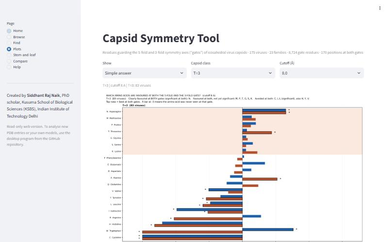
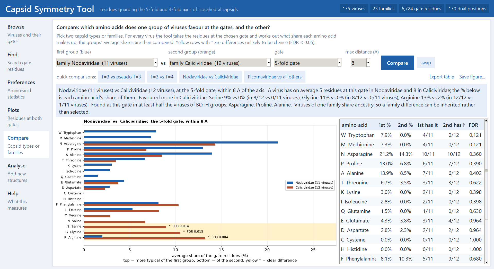

<p align="center"></p>

<h1 align="center">Capsid Symmetry Tool</h1>

<p align="center">
<a href="https://github.com/siddhantrajnaik/capsid-symmetry-tool/actions/workflows/test.yml"></a>
<a href="https://github.com/siddhantrajnaik/capsid-symmetry-tool/actions/workflows/pages.yml"></a>
<a href="LICENSE"></a>
</p>

Siddhant Raj Naik, PhD scholar, Kusuma School of Biological Sciences, IIT Delhi
([siddhantrajnaik@gmail.com](mailto:siddhantrajnaik@gmail.com))

**Try it in the browser:** [is.gd/capsidtool](https://is.gd/capsidtool)

## Why I made this

Icosahedral virus capsids have openings where their symmetry axes pass through the shell. Five subunits meet at
each 5-fold axis and three at each 3-fold axis. I wanted to know which amino acids line these openings, and
whether the same residue ever sits at both kinds of axis. In Flock House virus (PDB 4FTB) it does. Met182 is
2.8 Å from the 5-fold axis in one subunit and 2.5 Å from the 3-fold axis in the other two. To see whether that
was a one-off, I ran the same measurement on 181 structures from the PDB, covering 175 viruses in 23 families
(T=3, T=4 and pseudo-T=3 capsids).

## What it does

For each structure the program reads the assembly operators that build the full capsid, rebuilds the icosahedral
group from them, and finds the capsid centre and all the 5-fold, 3-fold and 2-fold axes. It then measures the
distance from every residue's side chain to the nearest axis of each kind. Residues within 8 Å of an axis are
counted as being at that axis (3, 6 and 10 Å are stored as well).

To check whether an amino acid is enriched near an axis, it compares it with residues of the same structure that
sit at the same radius in the shell but away from any axis. The viruses are pooled with a Cochran-Mantel-Haenszel
test and the p-values are corrected for testing 20 amino acids.

The results are in `gate_residues.sqlite`, which you can browse in the web version or the desktop program.

Two more views build on the same data. The 3D view loads any of the structures from the PDB and colours the
residues near each axis on the whole capsid, so you can see the rings they form around the openings. The pore
chemistry view adds up what lines each opening, counting every copy around the pore: net charge, hydropathy,
how many aromatic or polar residues, and how bulky they are, compared across capsid types or families.



## Running it on your computer

On Windows, download the repository (Code, then Download ZIP) and double-click `Capsid Symmetry Tool.bat`. The
first start sets up its own Python environment in a `.venv` folder. That needs Python 3.11 to 3.13 from
python.org and an internet connection, and takes a few minutes. After that it opens straight away.

On other systems:

```bash
python -m venv .venv
.venv/bin/pip install -r requirements.txt
.venv/bin/python gate_explorer.py
```

The desktop version has an Analyse page where you can run new PDB IDs or your own model files and add them to
the database. The web version can only look things up.



From the command line:

```bash
python gate_residue_analysis.py --pdb 4ftb --residue 182 --out results/fhv
python gate_residue_analysis.py --csv representatives.csv --sens 3 6 10 --out results/all
python gate_plots.py --simple --class "T=3" --cutoff 3 --out plots/t3_3A.png
python gate_compare.py --a "family=Nodaviridae" --b "family=Caliciviridae" --gate 5-fold
python gate_stemleaf.py --class "T=3" --aa M
python gate_chemistry.py --gate 3-fold --by family --metric net_charge --out plots/charge_3fold.png
python gate_db.py add --db gate_residues.sqlite --run results/fhv
```

## Files

- `gate_residue_analysis.py` finds the axes, measures distances and does the statistics.
- `gate_db.py` builds and updates the database from analysis output folders.
- `gate_explorer.py` is the desktop window.
- `gate_chemistry.py` works out the charge and chemistry of each opening.
- `gate_plots.py`, `gate_compare.py` and `gate_stemleaf.py` make the figures. The window, the web version and the
  command line all use them.
- `gate_env.py` checks that all the libraries load before a run starts.
- `web/` holds the browser version; `web/viewer3d.py` sets up the 3D view (Mol*, PDBe build).
- `representatives.csv` lists one row per virus with candidate PDB IDs.

## Limitations

Being close to an axis doesn't mean a residue blocks the pore. Distance from the axis line isn't the same as pore
radius. I only use atomic models, not density maps, and I don't look at the quasi-3-fold axes of T=3 capsids.
Viruses in the same family are related, so a pattern inside one family could just be inherited.

The structures come from the [RCSB PDB](https://www.rcsb.org/). If you write about a particular structure, please
cite its original paper.

## Citing

If this is useful in your work, please cite it. GitHub's "Cite this repository" button gives the details, or:

> Naik, S. R. (2026). Capsid Symmetry Tool. Kusuma School of Biological Sciences, IIT Delhi.
> https://github.com/siddhantrajnaik/capsid-symmetry-tool

Questions, corrections or structures you'd like added: siddhantrajnaik@gmail.com

MIT licence, see [LICENSE](LICENSE).
